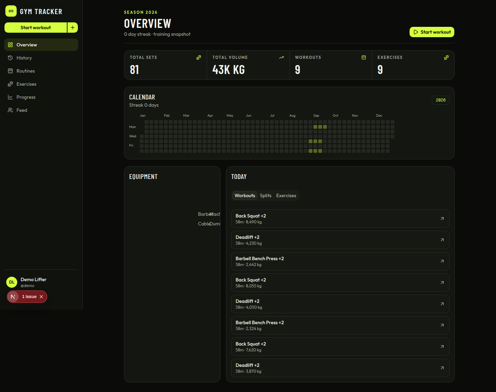
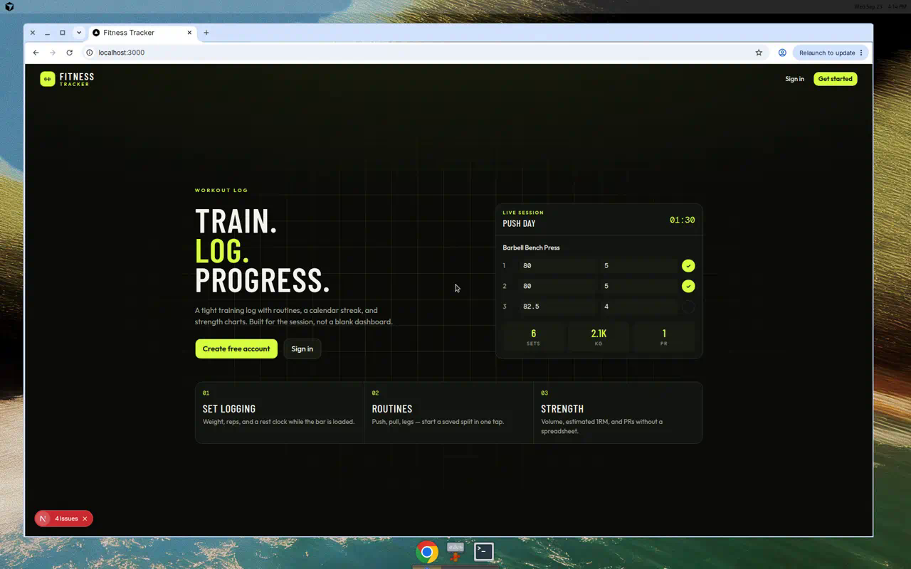
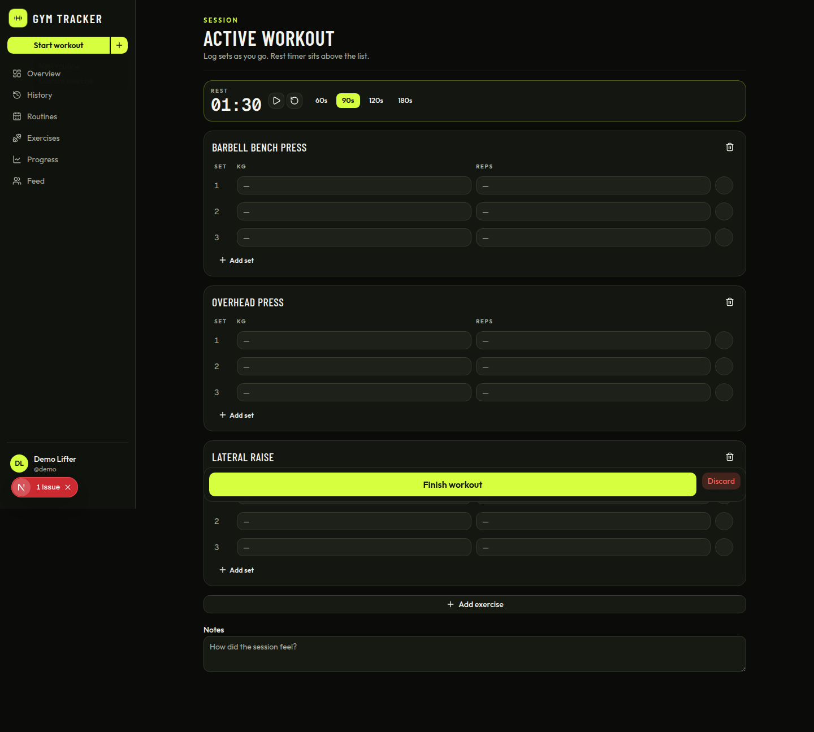
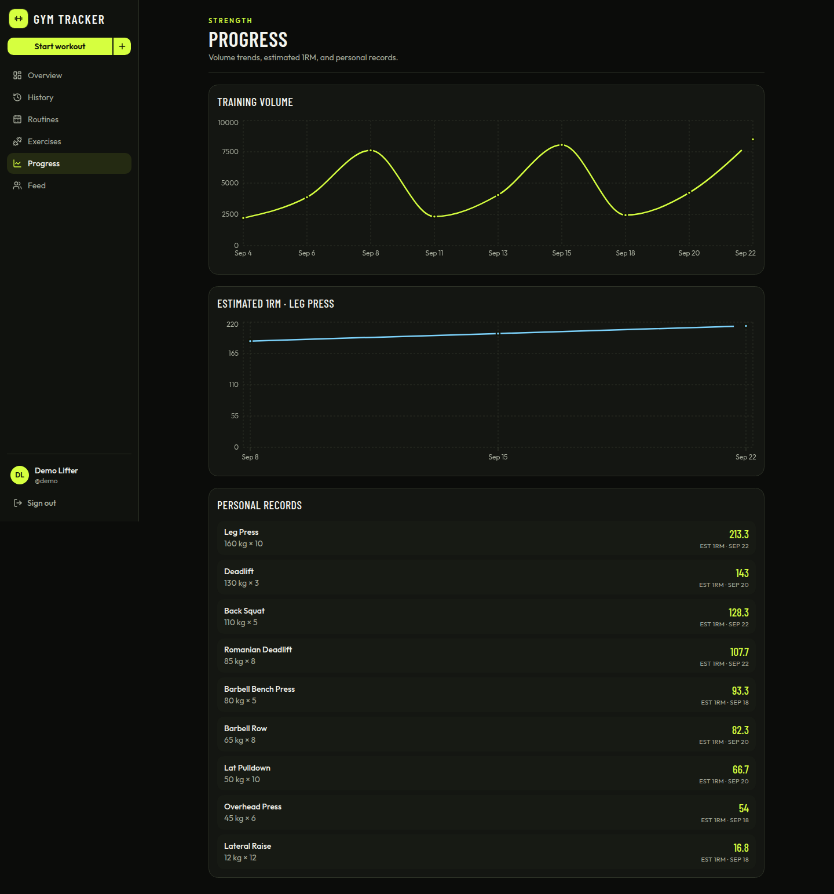
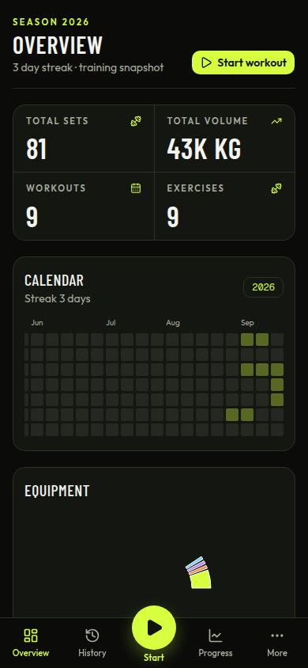
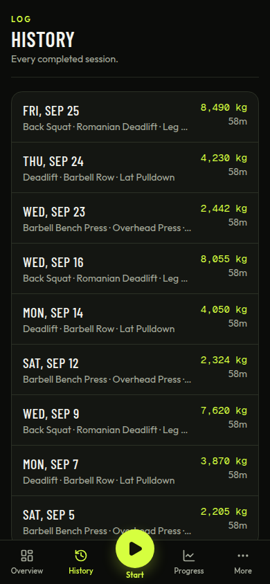
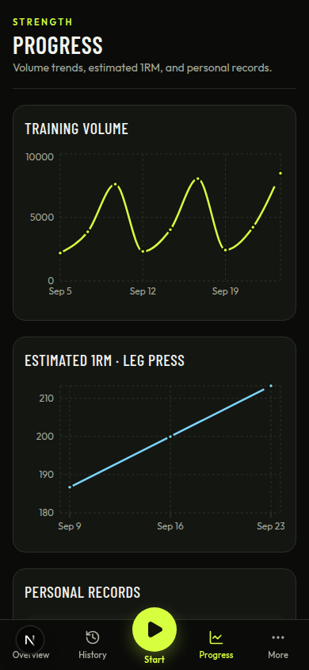
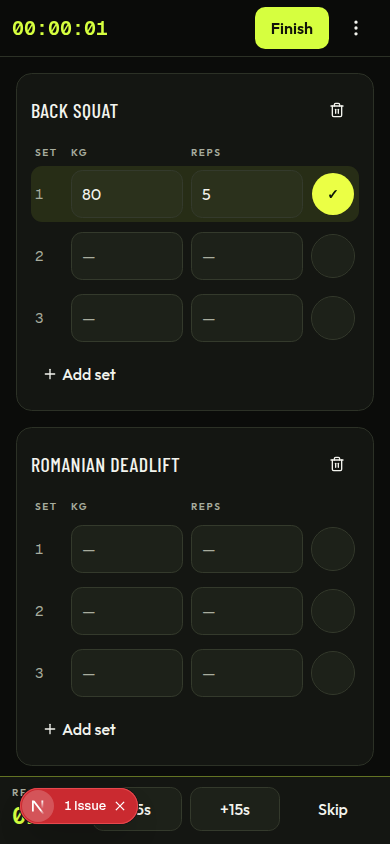

# Gym Tracker



A workout logger in the style of Strong and Hevy. Log sets fast, save routines, and watch your lifts go up on a chart.

Live: https://gym-app-tracker-gamma.vercel.app. Tap **Use demo account** on the sign-in page. The demo data resets every night at 3 AM Manila time.

## What it does

- Email and password sign-in. Google shows up if you set the Google env vars.
- 53 seeded exercises, plus your own.
- Routine templates you can reuse.
- Live workout logging with a rest timer.
- History, training volume, estimated 1RM, personal records, and a training heatmap.
- Profiles, follows, a feed, and likes.

Built with Next.js 16, React 19, TypeScript, Prisma 6 on Postgres, Auth.js v5, Tailwind 4, shadcn/ui and Recharts. Hosted on Vercel with Neon.





On a phone:






## Run it

With Docker:

```bash
cp .env.example .env
docker compose up --build
npx prisma migrate deploy
npm run db:seed
```

The web container already runs the migration and seed on boot, so the last two are only needed if you're running them yourself. Compose sets its own database URL and dev `AUTH_SECRET`. Open http://localhost:3000. Postgres is on `localhost:5432` (`postgres` / `postgres` / `gymtracker`). If you already run Postgres on 5432, stop it first or the ports will clash.

The seed creates a demo lifter, `demo@gymtracker.local` / `gymtracker`, with about three weeks of sessions.

Stop with `docker compose down`. Add `-v` to wipe the database. There are npm shortcuts too: `npm run docker:up`, `docker:down`, `docker:logs`.

Without Docker you need Node 20+ and Postgres 16:

```bash
npm install
cp .env.example .env   # fill in DATABASE_URL, DIRECT_URL, AUTH_SECRET, AUTH_URL
npx prisma migrate deploy
npm run db:seed
npm run dev
```

Make a secret with `openssl rand -base64 32`. Locally, `DATABASE_URL` and `DIRECT_URL` are the same URL.

## Env

| Variable | Notes |
| --- | --- |
| `DATABASE_URL` | Pooled Postgres URL. On Neon, the `-pooler` host. For PgBouncer add `pgbouncer=true&connection_limit=1`. |
| `DIRECT_URL` | Unpooled URL, used by migrations. Neon calls it `DATABASE_URL_UNPOOLED`. |
| `AUTH_SECRET` | Required. |
| `AUTH_URL` | Public origin, no trailing slash. Set `NEXTAUTH_URL` to the same. |
| `AUTH_TRUST_HOST` | `true` behind Docker or Vercel. |
| `AUTH_GOOGLE_ID`, `AUTH_GOOGLE_SECRET` | Optional. Both must be set for the Google button. |
| `CRON_SECRET` | Required in production, for the demo reset cron. |

## Deploying

Vercel runs `npm run vercel-build`, which is `prisma generate && next build`. It never touches the database, because preview and production share one `DATABASE_URL` and a migration in the build would hit production from any branch.

Run production migrations by hand, after the change is merged and before the code that needs it ships:

```bash
DIRECT_URL="<production direct url>" DATABASE_URL="<production direct url>" npx prisma migrate deploy
```

Don't use `prisma db push` there. Google callback for a new domain: `https://<your-domain>/api/auth/callback/google`.

`vercel.json` calls `GET /api/cron/reset-demo` at `0 19 * * *` (03:00 Manila). It wipes and rebuilds only the demo user's data and restores its login. Visitors can't change the demo account's email or password or delete it. The same route bootstraps an empty database:

```bash
curl -H "Authorization: Bearer $CRON_SECRET" https://<your-domain>/api/cron/reset-demo
```

Railway Postgres works too if both URLs point at `DATABASE_PUBLIC_URL`. Free instances sleep, so retry after a cold start.

## Notes

- Estimated 1RM is Epley, `weight × (1 + reps / 30)`, one decimal. A single rep returns the weight (`src/lib/workout-utils.ts`).
- Warmup sets and unfinished sets don't count toward volume.
- `/feed` shows your finished workouts and those of people you follow.
- `GOOGLE_CLIENT_ID` / `GOOGLE_CLIENT_SECRET` still work if the `AUTH_GOOGLE_*` pair isn't set.
- Other scripts: `lint`, `db:migrate`, `db:push` (local experiments only), `db:studio`.

MIT licensed.
